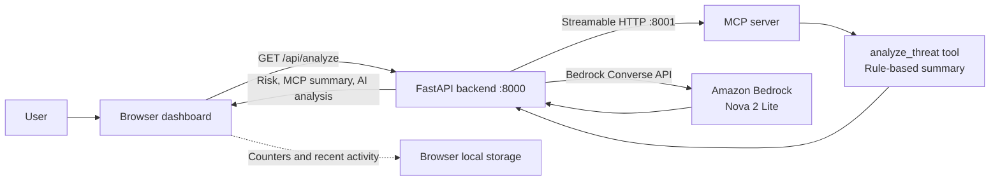

# CyberGuard AI — IoT Threat Analysis Prototype

CyberGuard AI is a hackathon prototype that demonstrates how a simple IoT network-traffic indicator can be turned into a readable risk summary and AI-generated security guidance. It combines a browser dashboard, a FastAPI backend, an MCP analysis tool, and Amazon Bedrock.

> **Prototype notice:** CyberGuard AI does not monitor live network traffic or independently detect attacks. Risk levels are assigned from a user-entered traffic multiplier using fixed thresholds. Results are illustrative only; they do not prove that a device is compromised and are not a guarantee of production-level security.

## Problem

IoT device operators may need help interpreting unusual traffic activity. Raw indicators can be difficult to understand and act on, especially for users without dedicated security tooling.

## Solution

The dashboard lets a user enter a device name and a traffic multiplier. The backend assigns a demonstration risk level, asks an MCP tool for a rule-based summary, and requests an explanation and suggested actions from Amazon Bedrock. The dashboard presents the results in one place.

## Features

- Browser-based dashboard for submitting a device name and traffic multiplier.
- Rule-based risk bands: **LOW** below 2×, **MEDIUM** from 2× to below 5×, and **HIGH** at 5× or above.
- MCP `analyze_threat` tool for a deterministic summary of the submitted indicator.
- Amazon Bedrock (Amazon Nova 2 Lite) for AI-generated assessment, possible causes, and suggested actions.
- Dashboard counters and recent activity stored in the browser's local storage.
- FastAPI health check at `/health`.

## Architecture



The risk level uses fixed traffic-multiplier thresholds in the FastAPI endpoint. The MCP tool also summarizes the multiplier, while Bedrock generates a separate natural-language analysis. The application sends the entered device name and multiplier to the configured Bedrock model; it does not collect or inspect device network packets.

## Technology Stack

- **Backend:** Python, FastAPI, Uvicorn, Boto3
- **Tool integration:** Model Context Protocol (MCP), Streamable HTTP transport
- **AI:** Amazon Bedrock Converse API, Amazon Nova 2 Lite
- **Frontend:** HTML, CSS, JavaScript
- **Cloud authentication:** AWS CLI or another Boto3-supported credential provider

## Project Structure

```text
CyberGuard-AI/
├── backend/
│   ├── main.py                 # FastAPI routes, MCP client, and Bedrock call
│   └── mcp_server.py           # MCP analyze_threat tool (port 8001)
├── frontend/
│   ├── index.html              # Dashboard served by FastAPI
│   └── README.md               # Frontend notes
├── demo_video/
│   ├── CyberGuard_AI_Complete_Demo_Final.mp4
│   └── ...                     # Captions and demo source assets
├── ai_agent.py                 # Standalone Bedrock assistant example
├── ai_mcp_agent.py             # Standalone MCP + Bedrock example
├── test_mcp.py
├── demo_video_script.md
├── LICENSE
└── README.md
```

## Demo

Final demo video: [`demo_video/CyberGuard_AI_Complete_Demo_Final.mp4`](demo_video/CyberGuard_AI_Complete_Demo_Final.mp4)

## Setup and Run

### Prerequisites

- Python 3.10 or newer.
- An AWS account with Amazon Bedrock access to the configured Amazon Nova 2 Lite model.
- AWS credentials configured locally through the AWS CLI or another supported Boto3 credential provider. The backend currently specifies AWS region `ap-south-1` and model ID `global.amazon.nova-2-lite-v1:0` in `backend/main.py`.
- Permission for the configured AWS identity to invoke the selected Bedrock model.

### Install dependencies

From the project root in PowerShell:

```powershell
py -m venv .venv
.\.venv\Scripts\Activate.ps1
python -m pip install --upgrade pip
python -m pip install fastapi uvicorn boto3 "mcp[cli]"
```

If PowerShell blocks activation, use the Python executable directly at `.venv\Scripts\python.exe` for the install and run commands.

### Configure AWS credentials

Authenticate locally using your normal AWS credential workflow (for example, AWS CLI or IAM Identity Center). Do not put access keys or other credentials in source files, README content, or committed `.env` files. The application uses Boto3's default credential chain.

### Start the application

Open two PowerShell terminals in the project root. Activate `.venv` in both, then start the MCP server first:

**Terminal 1 — MCP server (port 8001):**

```powershell
python backend\mcp_server.py
```

**Terminal 2 — FastAPI backend (port 8000):**

```powershell
python -m uvicorn backend.main:app --reload --port 8000
```

Open [http://127.0.0.1:8000](http://127.0.0.1:8000) for the dashboard. The health endpoint is [http://127.0.0.1:8000/health](http://127.0.0.1:8000/health).

## Limitations and Responsible Use

- This is a demonstration prototype, not a production intrusion-detection system.
- The input is a manually supplied multiplier, not measured network telemetry; the fixed thresholds are illustrative and have not been validated against real attack data.
- A risk label does not prove compromise or identify an actual attack.
- AI-generated explanations and recommendations may be inaccurate or incomplete and should not be treated as definitive security findings.
- The project does not provide production controls such as authentication, authorization, hardened deployment, centralized audit logging, or validated detection performance.

## Hackathon Readiness

The repository includes the application source and the final demo video path above. Before submission, confirm the target event's repository visibility, required submission form/materials, and whether the untracked demo assets and script should be committed. The local demo video is not currently tracked by Git, so it will not be included in a repository submission unless it is added and committed.
